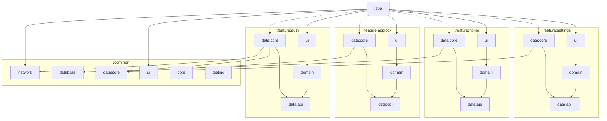

# Vigil

[](https://github.com/kristiankosharov/Vigil/actions/workflows/ci.yml)

An Android app built on a strict, tool-enforced architecture: multi-module Clean Architecture with
MVI, where every convention is checked by the build rather than by memory. It is also set up to be
developed together with Claude Code.

<!-- TODO: one or two sentences on what Vigil does for its users. -->

## The idea

Most app codebases start clean and drift: layers leak into each other, error handling gets
inconsistent, and "we always do it this way" lives only in people's heads. Vigil is built the other
way round: the rules come first, and they are executable.

- **Every rule is enforced.** Module dependencies are checked when Gradle configures the build;
  architecture and naming rules run as [Konsist](https://docs.konsist.lemonappdev.com/) tests;
  detekt bans `!!`, `GlobalScope`, `runCatching` in suspend code and hardcoded dispatchers; ktlint
  formats every file; Android Lint and an R8 release build run in CI.
- **One way to do each thing.** Every repository returns `AppResult` and never throws; all I/O goes
  through `safeApiCall` / `safeDbCall` / `safeStoreCall`; every screen is the same MVI shape
  (`UiState`, `Action`, a ViewModel that builds its state with a `@Composable uiState()`, a
  logic-free `Route` and a stateless `Screen`).
- **Secure by default.** Small data lives in typed DataStores encrypted with Tink and an Android
  Keystore key; the whole app sits under a PIN + biometric lock; nothing sensitive is logged or
  written to saved state.
- **Ready for an AI pair programmer.** `CLAUDE.md`, `.claude/rules/`, `.claude/skills/` and
  `.claude/reference/` give Claude Code the same rules a human would follow, loaded only when the
  files being edited need them, and hooks format and check its changes automatically.

### What is there today

The features are wired through every layer but intentionally thin: the backend and real forms come
next.

| Feature | Status |
|---|---|
| **Login** (`:feature:auth`) | Working with **Firebase Auth**: email + password (sign in, create account, password reset) and phone number with an SMS code (auto-verification included). OpenID Connect is structured (repository, use case, SSO buttons) but has no provider yet: see `TODO(oidc)`. Bearer-token plumbing for the future backend (encrypted token store, refresh, session expiry → back to login) is in place; exchanging the Firebase ID token for backend tokens is a `TODO(auth)`. |
| **App lock** (`:feature:applock`) | Working. 6-digit PIN with a custom number pad, onboarding (create → confirm → enable fingerprint), unlock with PIN or fingerprint, locks on start and after 30 s in the background, covers the whole app. |
| **Home** (`:feature:home`) | Placeholder screen reading entries from Room (empty for now). |
| **Settings** (`:feature:settings`) | Working. Appearance: light, dark or the device setting, stored in an encrypted DataStore and applied to the whole app (the security screens stay dark). Opened from the icon on Home. |

Open items are marked in the code as `TODO(auth)`, `TODO(oidc)`, `TODO(home)`, `TODO(applock)`
and `TODO(env)`.

**Firebase Auth setup:** the Email/Password and Phone providers are enabled in the Firebase project
`vigil-app-25b0`. Phone sign-in needs the app's SHA-1/SHA-256 registered in Firebase (each
developer's debug key and the release key) and, for real SMS, the Blaze plan; test numbers
(Authentication → Sign-in method → Phone) work without either.

**Design:** the design system (colors, type, states, components) and every screen flow are described
in [`docs/design/README.md`](docs/design/README.md). The theme and shared components are in
`:common:ui` (`theme/` and `designsystem/`).

## Requirements

| Tool | Version | Notes |
|---|---|---|
| macOS or Linux | — | `scripts/check.sh` and the hooks are bash scripts. |
| JDK | 17 or newer | Compiles with a Java 17 toolchain. The Gradle daemon runs on **Java 21** (`gradle/gradle-daemon-jvm.properties`) and Gradle downloads it if missing; keep it at 21, because detekt 1.23 can't run on Java 25. |
| Android Studio | one that supports AGP 9.4 | Optional; everything also runs from the command line. |
| Android SDK | platform **37** | `compileSdk` / `targetSdk` 37, `minSdk` 26. |
| Device or emulator | Android 8.0 (API 26)+ | For running the app and the instrumented tests. |
| [ktlint](https://github.com/ktlint/ktlint/releases) | **1.8.0** exactly | The only formatter. The version is pinned in `gradle/libs.versions.toml`; a different version is reported as an error. Homebrew may ship an older one, so install it from the GitHub release if needed. |
| `jq` | any | Used by the Claude Code hooks (built into macOS 15+). |
| Claude Code | — | Optional. |

Gradle 9.8.2 comes with the wrapper; you don't need to install it.

## Getting started

```bash
git clone git@github.com:kristiankosharov/Vigil.git
```

Create `local.properties` with your SDK path (Android Studio does this when you open the project):

```properties
sdk.dir=/Users/you/Library/Android/sdk
```

Build the dev app, then install it on a running emulator or device:

```bash
scripts/check.sh build
```

```bash
adb install -r app/build/outputs/apk/dev/debug/app-dev-debug.apk
```

### Flavors and environments

| Flavor | Application ID | API base URL |
|---|---|---|
| `dev` | `app.vigil.dev` | placeholder (`TODO(env)`) |
| `staging` | `app.vigil.staging` | placeholder |
| `prod` | `app.vigil` | placeholder |

The URLs are `buildConfigField`s in `app/build.gradle.kts`; only `:app` reads `BuildConfig`.

Release builds are signed only when these environment variables are set (on CI); without them the
release build is unsigned but still runs R8:
`RELEASE_KEYSTORE_PATH`, `RELEASE_KEYSTORE_PASSWORD`, `RELEASE_KEY_ALIAS`, `RELEASE_KEY_PASSWORD`.

## Checks

All checks go through one script that prints a line per step and, on failure, only what is needed
to fix it (failing tests with their messages, compiler/detekt/lint findings). Full logs are in
`build/check-logs/`.

| Command | What it does |
|---|---|
| `scripts/check.sh format` | ktlint on every Kotlin file (`ktlint --format <file>` fixes one) |
| `scripts/check.sh detekt` | static analysis with the Compose rules |
| `scripts/check.sh konsist` | architecture and naming rules |
| `scripts/check.sh tests [:module …]` | unit tests (Kotest, MockK, Turbine, Molecule) |
| `scripts/check.sh android [:module …]` | instrumented tests (Compose UI, accessibility checks); says clearly when no device is connected |
| `scripts/check.sh build` | compiles the dev debug app |
| `scripts/check.sh release` | Android Lint + R8 release build |
| `scripts/check.sh all` | the CI order: format, detekt, konsist, tests, lint, release |

## CI/CD (GitHub Actions)

| Workflow | Runs on | What it does |
|---|---|---|
| [`ci.yml`](.github/workflows/ci.yml) | every pull request and push to `main` | **Checks:** `scripts/check.sh all` (ktlint, detekt, Konsist, unit tests, lint, R8 APK + AAB). **UI tests:** `scripts/check.sh android` on an API 35 emulator, in parallel. Reports are uploaded when a job fails. |
| [`release.yml`](.github/workflows/release.yml) | a pushed `v*` tag | The full checks, then a **signed** prod APK and AAB, published with the R8 `mapping.txt` as a GitHub Release. |
| [`dependabot.yml`](.github/dependabot.yml) | weekly | Update PRs for the GitHub Actions and Gradle dependencies. |

Both workflows share [`.github/actions/setup`](.github/actions/setup/action.yml) (JDK 17 + 21, the
Gradle cache, and the pinned ktlint, checked against its SHA-256). Actions are pinned to commit
SHAs.

### Branches (git flow)

| Branch | From | Merges into |
|---|---|---|
| `main` | — | released code only, every merge tagged `vX.Y.Z` |
| `develop` | `main` | integration branch |
| `feature/<name>`, `bugfix/<name>` | `develop` | `develop` |
| `release/<X.Y.Z>` | `develop` | `main`, then back into `develop` |
| `hotfix/<X.Y.Z>` | `main` | `main`, then back into `develop` |

CI runs on pull requests into `main` and `develop` and on pushes to `main`, `develop`, `release/*`
and `hotfix/*`.

### Release signing secrets

Add these under **Settings → Secrets and variables → Actions → New repository secret**. The release
workflow stops if any is missing, so it can never publish an unsigned build.

| Secret | Value |
|---|---|
| `RELEASE_KEYSTORE_BASE64` | the keystore file, Base64-encoded (`base64 -i release.jks \| pbcopy` on macOS) |
| `RELEASE_KEYSTORE_PASSWORD` | the keystore password |
| `RELEASE_KEY_ALIAS` | the key alias |
| `RELEASE_KEY_PASSWORD` | the key password |

### Cutting a release

1. Branch `release/0.1.0` from `develop`; only fixes go in from here.
2. Open a PR into `main`; merge it when CI is green.
3. Tag `main` and push the tag. The tag starts the release workflow:

   ```bash
   git checkout main && git pull && git tag v0.1.0 && git push origin v0.1.0
   ```

4. Merge `main` back into `develop`.

Tags must be `vMAJOR.MINOR.PATCH`. The version name comes from the tag and the version code is
derived from it (`v1.2.3` → `1002003`), so it always grows.

The release then appears under **Releases** with `vigil-0.1.0.apk`, `vigil-0.1.0.aab` and
`vigil-0.1.0-mapping.txt`.

## Architecture

```
:app                        Application, MainActivity, all navigation (Navigation 3), flavors

:common:core                AppResult, AppError, dispatchers, application scope (pure Kotlin)
:common:network             Ktor clients, bearer auth, safeApiCall
:common:database            the single Room 3 AppDatabase, one package per feature, safeDbCall
:common:datastore           encrypted typed DataStore (Tink), safeStoreCall
:common:ui                  theme, UiText, BaseViewModel, effect and navigation handlers
:common:testing             test helpers

:feature:<name>:ui          screens and ViewModels
:feature:<name>:domain      domain models and use cases (pure Kotlin)
:feature:<name>:data:api    repository interfaces (pure Kotlin)
:feature:<name>:data:core   repository implementations, APIs, storage (internal)

:konsist                    architecture tests
build-logic                 vigil.* convention plugins and the dependency-rule check
```

### Module dependencies

Who depends on whom, from the `build.gradle.kts` files. Arrows point from a module to what it
depends on. Not drawn, to keep it readable: every module depends on `:common:core`, every feature
`ui` (and `:app`) on `:common:ui`, and tests on `:common:testing`. `:app` depends on each
`data:core` only so Hilt can collect its bindings (dotted).



`:konsist` (architecture tests) and `build-logic` (convention plugins, `enforceDependencyRules()`)
read the other modules but are not part of the app's graph. **Keep this graph in sync:** any change
that adds, removes or rewires a module updates it in the same commit (rule in `CLAUDE.md`).

- `ui → domain → data:api`; `ui` never sees a `data` module, and features see each other only
  through `:data:api`.
- Everything crossing a boundary is an interface; implementations are `internal` and bound with
  Hilt.
- The app is layered as `AppLockHost { AuthSessionHost { NavDisplay } }`, so the lock screen covers
  everything.

The full rules are in [`CLAUDE.md`](CLAUDE.md) and `.claude/rules/`.

### Tech stack

| Area | Libraries |
|---|---|
| Build | AGP 9.4 (built-in Kotlin), Kotlin 2.4, KSP, Gradle 9.8, version catalog, convention plugins |
| UI | Jetpack Compose (BOM 2026.09), Material 3, Navigation 3, Lifecycle ViewModel |
| DI | Hilt (KSP), including pure-Kotlin modules |
| Data | Room 3 with the bundled SQLite driver, DataStore 1.3 + `datastore-tink`, Paging 3 |
| Network | Ktor 3 (OkHttp engine), kotlinx.serialization, bearer auth |
| Security | Tink, Android Keystore, `androidx.biometric` |
| Async / logging | Coroutines + Flow, Timber, Firebase Crashlytics (release builds) |
| Sign-in | Firebase Auth (email/password, phone; OpenID Connect prepared) |
| Testing | Kotest, MockK, Turbine, Molecule, Compose UI tests, Ktor `MockEngine` |
| Quality | Konsist, detekt + Compose rules, ktlint, Android Lint |

Exact versions are in [`gradle/libs.versions.toml`](gradle/libs.versions.toml); the rule is always
the latest stable release.

## Working with Claude Code

- [`CLAUDE.md`](CLAUDE.md) holds the rules for every change; `.claude/rules/` adds rules per layer,
  loaded automatically when matching files are edited.
- `.claude/skills/` has step-by-step procedures: new feature, new screen, Room table, DataStore,
  paged list, release check.
- `.claude/reference/` has the reference code; once the real code exists, the source wins.
- Hooks in `.claude/settings.json` format every Kotlin file Claude edits with the pinned ktlint and
  run Konsist before it finishes a turn.

## License

[Apache License 2.0](LICENSE)
