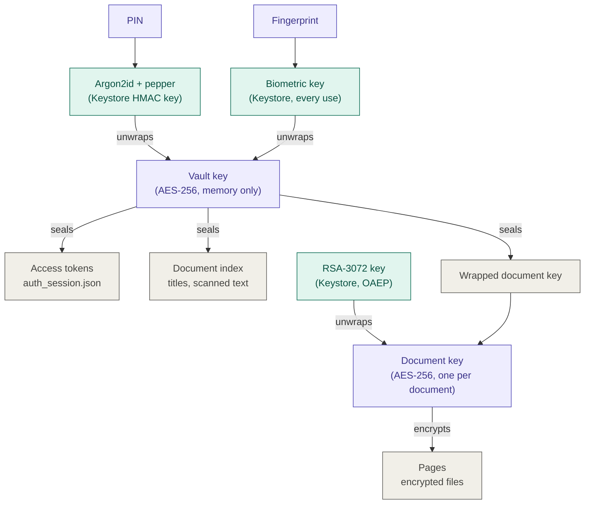
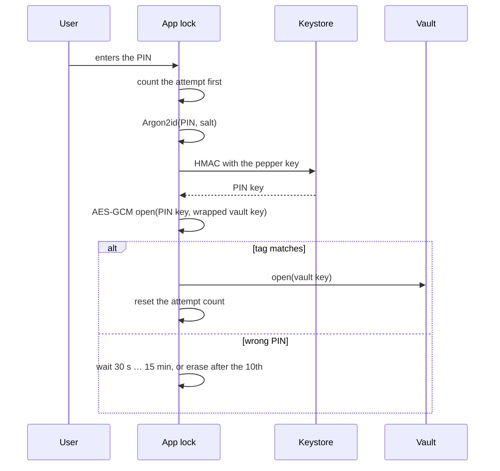
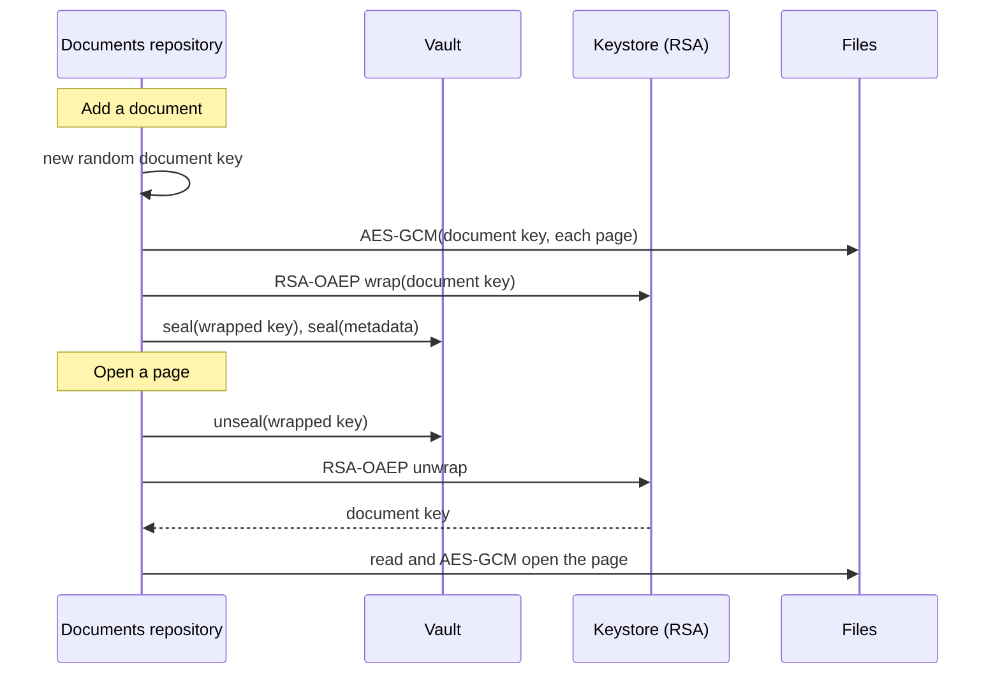

# Encryption

How Vigil protects the PIN, the backend tokens and the documents on the device. The code is the
source of truth: `:common:security`, `:feature:applock:data:core`, `:feature:auth:data:core`
(`TokenStorageImpl`) and `:feature:documents:data:core`.

## Key hierarchy

Teal: keys inside the Android Keystore (they never leave secure hardware). Purple: secrets and keys
that exist only in memory. Gray: what is stored on disk, always encrypted.

Every DataStore file (`applock_settings.json`, `auth_session.json`, `documents_index.json`, …) is also
encrypted as a whole by Tink with a Keystore-backed AES-256-GCM key (`:common:datastore`). That outer
layer is not drawn: it protects the files at rest, but it opens without the PIN.

## The PIN and the vault key

The PIN is never stored, not even as a hash. It is part of the key that decrypts everything else.

1. **PIN key:** `HMAC-SHA256(pepper, Argon2id(PIN, salt))` (`PinKeyDerivation`).
   - Argon2id (Bouncy Castle) with the OWASP baseline: 19 MiB, 2 passes, 1 lane. The cost is stored
     with each wrapped key (`KdfParams`), so it can be raised later.
   - The pepper is a non-exportable Keystore HMAC key (`vault_pin_pepper_v1`, StrongBox when the
     phone has one, else the TEE). A guess can only be checked on this phone: copying the files
     somewhere else gives an attacker nothing to brute-force.
2. **Vault key:** a random AES-256 key, stored only as `AES-GCM(PIN key, vault key)` in
   `applock_settings.json`.
   - A PIN is right exactly when that decrypts (the GCM tag matches).
   - While unlocked the key sits in memory (`Vault`); locking wipes it.
3. **Fingerprint:** a second copy of the vault key, encrypted by a Keystore AES-GCM key that works only
   right after a strong-biometric check (`vault_biometric_v1`). BiometricPrompt always gets a
   `CryptoObject`, so the fingerprint really decrypts the key instead of only saying "yes". Adding or
   removing a fingerprint destroys that key; fingerprint unlock then turns itself off and the PIN
   still works.

### Wrong PINs

- 5 free tries, then waits of 30 s, 1 min, 5 min and 15 min (`PinAttemptPolicy`).
- The 10th wrong PIN erases every user's data (`UserDataCleaner`s, the biometric key, the documents'
  RSA key) and signs out.
- The count is written **before** each check, so killing the app mid-check never gives a free try.
- Waits use the time since boot, not the wall clock; after a reboot the full wait applies again.

### Other PIN rules

- Easy PINs are refused on Create: one repeated digit, runs up or down, well-known PINs, anything
  that reads as a date (`PinRules.isWeak`).
- PINs live in `CharArray`s that are wiped after use (`PinBuffer`), never in `String`s or saved state.
- The whole app has `FLAG_SECURE`: no screenshots, screen recording or recents thumbnail.

## Backend tokens

`TokenStorageImpl` seals the tokens with the vault key (associated data `vigil.auth.tokens`), so the
app has no tokens while it is locked. Sign-in happens before the PIN exists: tokens from then wait in
memory and are sealed once the PIN is created. If the app dies first, the user signs in again.

Known gap: Firebase keeps its own refresh token outside the vault. Once the backend exists, the app
exchanges the Firebase ID token for backend tokens and then signs out of Firebase (`TODO(auth)`).

## Documents (envelope encryption)

Each document has its own random AES-256 **document key**.

| What | Encrypted with | Stored in |
|---|---|---|
| Pages | AES-GCM with the document key; associated data `vigil.documents.page:<id>:<page>` | `noBackupFilesDir/documents/<id>/<page>.bin` |
| Document key | RSA-OAEP with the Keystore key `documents_kek_v1`, then AES-GCM with the vault key | `documents_index.json` |
| Title, status, page count, scanned text | AES-GCM with the vault key; associated data `vigil.documents.metadata:<id>` | `documents_index.json` |

- **Two locks on every document:** opening a page needs both the Keystore (RSA private key, which
  never leaves it) and an unlocked app (the vault key).
- **Bound to its place:** every sealed value carries its document id (and page number) as associated
  data, so pages and keys can't be swapped between documents.
- **Delete = forget the key:** deleting a document removes its wrapped key first; from then on its
  pages can never be decrypted, even if deleting the files fails.
- **Key rotation:** a new RSA key gets a new alias (`documents_kek_v2`). Rotating re-wraps only the
  small document keys; the page files stay as they are.
- **No backups:** the pages are in `noBackupFilesDir` and the DataStore files are excluded from
  backup. They couldn't be decrypted on another phone anyway.
- **RSA details:** RSA-3072 in the TEE (StrongBox only guarantees RSA-2048). OAEP uses SHA-256 with
  MGF1 SHA-1, the only MGF1 digest the Keystore accepts before Android 15; that is still sound for
  OAEP. Wrapping uses a software copy of the public key, so it needs no Keystore call.

## What erases what

| Event | Effect |
|---|---|
| App locked (start, 30 s in the background, "Lock wallet now") | Vault key wiped from memory: no tokens, no document list, no pages |
| 10th wrong PIN | Every `UserDataCleaner` runs, the biometric key is deleted, the user is signed out |
| Logout | Every `UserDataCleaner` runs: tokens, PIN wrap, document index, pages and the documents' RSA key |
| Fingerprints added or removed | Biometric key destroyed; fingerprint unlock turns off, the PIN still works |
